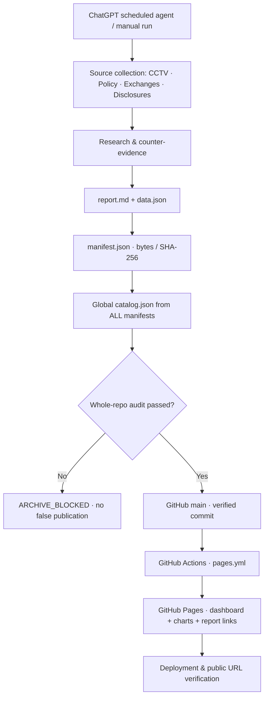

<div align="center">

# cron-news

**Evidence-first research intelligence · GitHub-native archive · Observable delivery**

把新闻与市场研究变成**可追溯、可审计、可复现、可视化**的公开数据资产。  
Turn scheduled research into verifiable public reports, structured datasets, and a searchable GitHub Pages dashboard.

[](https://github.com/1998x-stack/cron-news/actions/workflows/audit.yml)
[](https://github.com/1998x-stack/cron-news/actions/workflows/pages.yml)
[](https://1998x-stack.github.io/cron-news/)
[](docs/SCHEMA_V2.md)

**[Research Dashboard](https://1998x-stack.github.io/cron-news/)** · **[Report Archive](reports/)** · **[Research Prompts](prompts/)** · **[Data Contract](docs/SCHEMA_V2.md)** · **[Build & Audit](https://github.com/1998x-stack/cron-news/actions)**

</div>

---

## Overview｜项目定位

`cron-news` 是以 GitHub 为公开事实来源的定时研究归档系统，而非自动选股工具或静态新闻聚合页。它把**原始证据、分析解释、市场检验、版本化文件和网站展示**链接起来；任何阶段失败都单独披露，不会因定时器已触发就报告“发布成功”。

| Research stream | Directory | 核心内容 | 发布时段（文档约定，Asia/Shanghai） |
| --- | --- | --- | --- |
| **MARKET** · Markets & News Lianbo | `reports/market/` | A/H/US 市场、新闻联播、政策传导与反证 | 08:00 / 12:00 / 20:00 / **20:30 专项** |
| **TECH** · AI & Computer Science | `reports/tech/` | AI/Agent、论文、工程项目与可复现性 | 08:00 |
| **CHINA** · China Media & Policy | `reports/china/` | 宏观、政策、社会与国际媒体分析 | 08:00 / 20:00 |

> **调度来源说明**：上述为仓库中的时段约定，真正的启动由外部 ChatGPT 定时任务配置管理；GitHub Actions **不执行定时研究采集**，只在报告推入 `main` 后做校验与 Pages 发布。仓库不能据此保证其他任务已在用户账户实际启用。

### What makes it different

- **Evidence before narrative**：一条政策、一项行情、一次新闻编排均尽量附原始 URL、事件/公开/抓取时间、来源级别与缺口。禁止凭文字篇幅猜测电视镜头秒数。
- **Causality discipline**：A 股 15:00 收盘、新闻联播一般 19:00 播出；晚间首次披露的内容**绝不倒因解释当天收盘**。
- **Schema-driven**：每次真实研究生成 Markdown 正文与 JSON 数据，SHA-256 manifest 逐文件验真；PDF/Word/PPTX 仅在真实生成且有效时附加。
- **Immutable & idempotent**：固定 `RUN_KEY`，只归档一次；拒绝覆写历史、孤儿附件、失真哈希和来源缺失。
- **Fail-closed publishing**：整库审计或 PR CI 不通过就不能 merge；仓库提交、Pages 构建、公网加载、邮件交付是**四个不同的状态**。

## Delivery architecture｜端到端工作流



**Source of truth**：`main` 中真实存在并经 manifest 校验的报告文件。`index.html` 不保存伪造报告列表，浏览器从 `catalog.json` 读取目录，并从 `data.json` 绘制有证据的数据图表。

### Release state model

| Stage | 完成条件 | 不能替代的证据 |
| --- | --- | --- |
| `RESEARCH_VERIFIED` | 报告事实可溯源且不捏造缺失数值 | 引用链接、时间口径、反证 |
| `ARCHIVE_VERIFIED` | 文件、manifest、全局 catalog 均在 `main` 且审计通过 | commit SHA、回读文件、CI |
| `PAGES_VERIFIED` | 对应 SHA 已部署，网页及所述报告文件在公网可取 | Pages run 结果及 HTTP 检验 |
| `EMAIL_VERIFIED`（仅适用任务） | 实际授权邮件发送、SENT 去重及附件确认 | message ID、收件人和附件清单 |

`PUBLISHED` / `DEGRADED` 是 **manifest 的研究资料质量标记**，不是 Pages / Email 已交付的证明。

## Explore an actual run｜查看一次真实运行

**2026-11-09 手动端到端验收**使用 `MARKET-2026-11-09-MANUAL-2327`，不会占用或覆盖次日定时任务的 `MARKET-2026-11-10-2030`。

- [阅读完整研究报告](reports/market/2026/11/09/MARKET-2026-11-09-MANUAL-2327/report.md)
- [查看结构化数据](reports/market/2026/11/09/MARKET-2026-11-09-MANUAL-2327/data.json)
- [核验 manifest](reports/market/2026/11/09/MARKET-2026-11-09-MANUAL-2327/manifest.json)
- [打开网页图表与报告详情](https://1998x-stack.github.io/cron-news/)

> 此处的研究是有来源的实际交易日验收，不是伪造的示例行情。**最终是否完成公开网页部署，以对应 GitHub Pages 工作流与真实公网检验为准**。

## Repository structure｜目录与职责

```text
cron-news/
├── .github/workflows/
│   ├── audit.yml                 # PR / push 全库校验
│   └── pages.yml                 # 仅主分支触发静态网站构建/发布
├── assets/
│   ├── dashboard.css             # 响应式网页样式
│   └── dashboard.js              # JSON 加载、来源与图表显示
├── docs/
│   ├── SCHEMA_V2.md              # v2 数据格式、幂等与发布协议
│   └── ARCHIVE_RECOVERY.md       # 二进制报告补档指南
├── prompts/
│   ├── README.md                 # Prompt 持有者与版本约定
│   ├── market.md                 # MARKET + 20:30 新闻联播专项
│   ├── tech.md                   # AI / CS 研究
│   └── china.md                  # 中国政策 / 媒体研究
├── reports/
│   ├── market/YYYY/MM/DD/<RUN_KEY>/
│   ├── tech/YYYY/MM/DD/<RUN_KEY>/
│   └── china/YYYY/MM/DD/<RUN_KEY>/
│       ├── report.md             # v2 必需：含来源的完整正文
│       ├── data.json             # v2 必需：可视化结构化数据
│       ├── manifest.json         # v2 必需：规范路径/字节/SHA-256
│       ├── report.pdf            # 可选，经签名/渲染验证
│       ├── report.docx           # 可选，真实 Office ZIP
│       └── report.pptx           # 可选，真实 Office ZIP
├── scripts/
│   ├── build_catalog.py          # 所有合法 manifest → catalog.json
│   ├── audit.py                  # 全库路径/内容/哈希完整性
│   └── publish_bundle.py         # 本地 Git 授权上传可验证 ZIP
├── tests/
├── index.html
├── catalog.json
├── AGENTS.md                     # 所有 agent 的强制归档规则
└── README.md
```

### One run, one deterministic key

- 定时 20:30：`MARKET-YYYY-MM-DD-2030`
- 明确手动启动：`MARKET-YYYY-MM-DD-MANUAL-HHMM`
- 规范位置：`reports/<agent>/YYYY/MM/DD/<RUN_KEY>/`
- 同一 key 重试时先查已归档文件与开放 PR，**不生成** `final` / `latest` / `copy`。
- 旧 schema-v1 的 PDF / DOCX / PPTX 归档仍兼容，只读保留，不通过伪造 Markdown 为它们补历史信息。

## Quickstart｜本地检验与发布

需要 Python 3.12+、Git、Node.js（用于前端静态语法检查）。**校验完全不要求 Gmail、付费行情 API 或 Notion。**

```bash
git clone https://github.com/1998x-stack/cron-news.git
cd cron-news

python3 -m unittest discover -s tests -v
python3 scripts/build_catalog.py --check
python3 scripts/audit.py
node --check assets/dashboard.js
```

本地预览网页（仅需静态服务，避免 `file://` 请求 JSON 的浏览器跨域限制）：

```bash
python3 -m http.server 8000
# 浏览器打开 http://localhost:8000/
```

需要提交一组真实文件时，先看 [schema v2](docs/SCHEMA_V2.md)。由完整 Git checkout 进行原子提交，或经 GitHub **隔离 PR → Archive integrity CI PASS → Merge** 的安全路径发布。不得把“PR 已创建”或“Pages 构建触发”当作成功。对于已生成并真实校验的二进制 ZIP 可使用：

```bash
python3 scripts/publish_bundle.py /path/to/verified-run.zip
```

该脚本依赖操作者现有 Git 鉴权；不会帮你获取凭据，更不会触发邮件发送。

## Publication & website QA｜发布验收

1. **Research**：完整稿/提要与日期分开；收盘前/收盘后信号分开；事实/推断/情景分开。
2. **Archive**：真实 `report.md`、`data.json`、`manifest.json`，字节和 SHA-256 一致；没有孤儿文件与重复 key。
3. **CI**：校验完整 `main` 预期合并树，所有 Python 与网页脚本检查成功。
4. **Deploy**：`pages.yml` 在 `main` 的目标 SHA 成功运行，并独立确认网页加载、`catalog.json` 包含该 `run_key`、报告 JSON/Markdown URL 有效。
5. **Presentation**：看板显示新增卡片、分类筛选正常；只画已知数字；缺失指标显示缺口，不画假 0。
6. **Email**：20:30 专项**默认没有授权收件人，不自动发送邮件**。只有原任务明确具备授权邮件配置时，才会检索 `SENT`、去重、发送、核实 message ID 与真实附件；未知发送结果不盲目重发。公共仓库绝不保存收件地址。

### Troubleshooting

| 症状 | 最快排查 | 如何处理 |
| --- | --- | --- |
| 网页为空 | [catalog.json](catalog.json) 中 `reports` 是否为空 | 没有真实归档时属预期；先运行一次实际研究 |
| PR 里有文件，但首页无报告 | PR 是否真正合并到 `main` | 先修复 CI 和合并，而非伪造 catalog |
| main 有报告，网页仍为空 | [Pages Actions](https://github.com/1998x-stack/cron-news/actions/workflows/pages.yml) 是否为最新 SHA | 检查部署错误、CDN 缓存、浏览器请求 |
| 有图表但数值不对 | `data.json` 的来源、as_of、市场范围及 `null` | 纠正数据并进行可审计修订，不回填编造行情 |
| 缺 PDF / Word / PPT | manifest 是否声明该格式 | v2 默认可选，未生成就不应显示下载按钮 |
| 有 Gmail 邮件却无 GitHub 档案 | 邮件状态与仓库状态是否分离 | 不重发相同 RUN_KEY 邮件，单独修复归档 |

## Governance & disclosure

- 公开仓库仅容纳**公开可引用研究**，不上传收件地址、密钥、企业内部资料、私人数据、付费正文或受版权保护的整篇稿件。
- 重要指标必须有公开来源；无法取得的值用 JSON `null`，不能用陈旧快照或假 URL 替代。
- 不使用过时“实时北向净流入”口径，不能把估算主力资金写成真实机构持仓。
- 全库反熵约束与角色规则见 [AGENTS.md](AGENTS.md)，数据结构与约定见 [SCHEMA_V2.md](docs/SCHEMA_V2.md)。
- 研究仅供信息参考，**不构成投资建议**，不承诺收益或未来事件。

---

<div align="center"><sub>Research integrity over appearance · Release evidence over status claims · Preserve history, never invent data.</sub></div>
